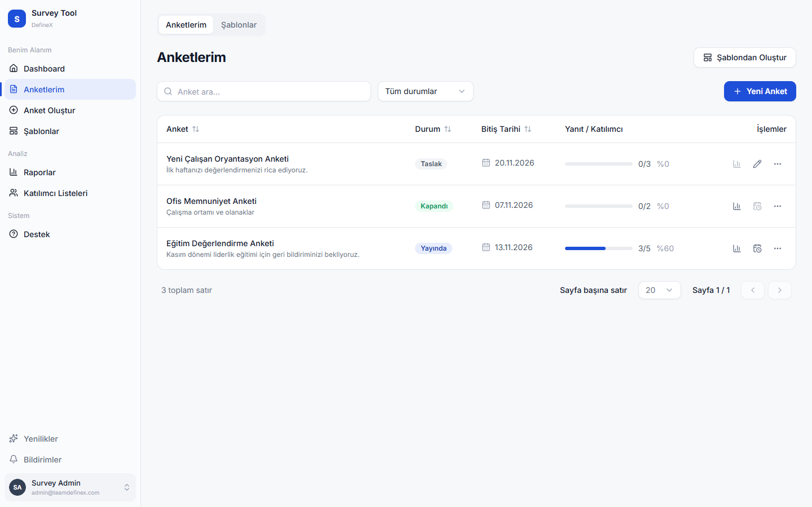
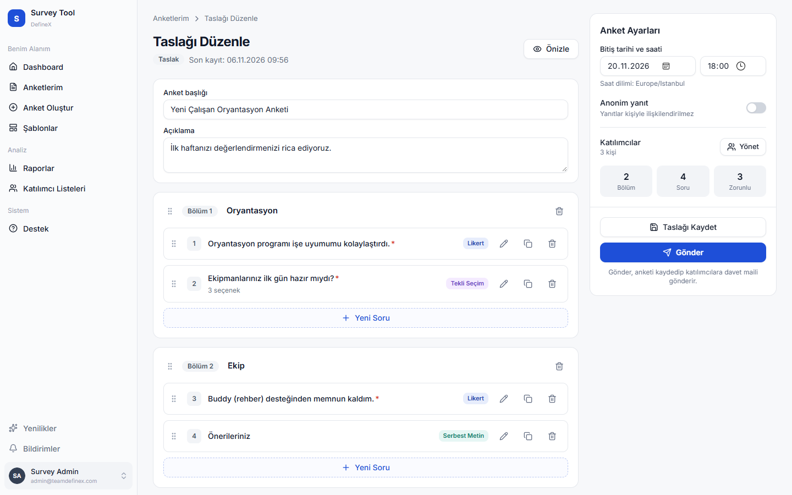
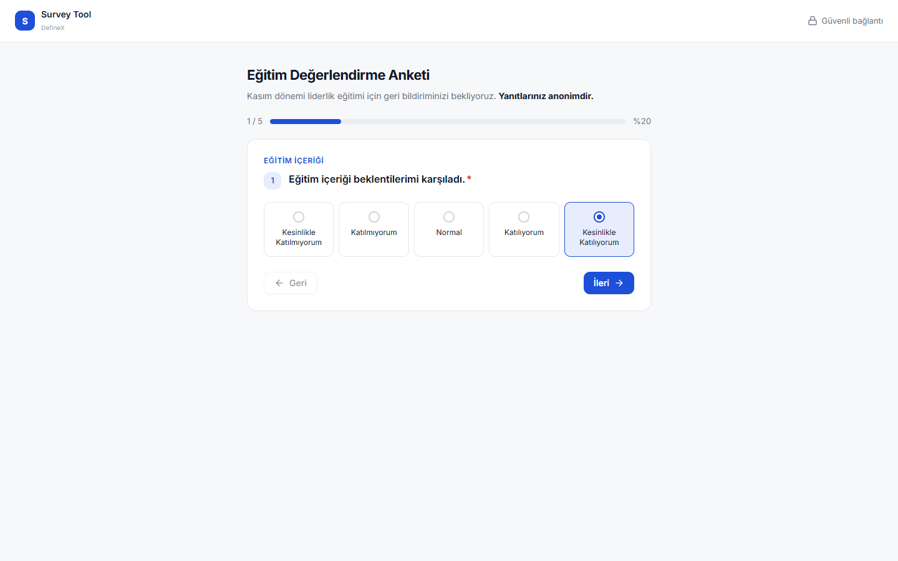
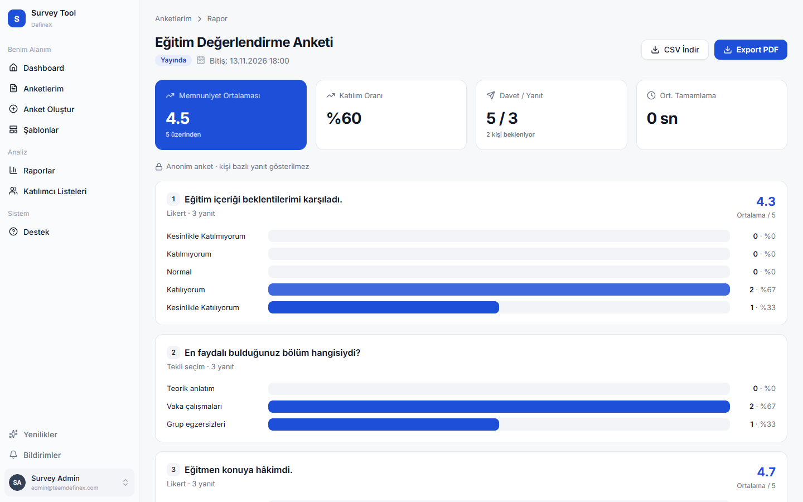

# Survey Tool

Kurum içi ve dışı anketleri hazırlamak, kişiye özel güvenli linklerle dağıtmak ve sonuçları raporlamak için bir web
uygulaması. Yöneticiler anketi bölümler ve sorularla kurar, katılımcı listesini yükler ve tek tıkla davet maillerini
gönderir. Katılımcılar hesap açmadan, maildeki linkle anketi yanıtlar.



## Özellikler

- **Anket oluşturma:** Bölümler; Likert (5'li), tekli seçim, çoklu seçim ve serbest metin soruları. Sürükle-bırak ile
  sıralama, zorunlu/opsiyonel soru, katılımcının göreceği haliyle önizleme.
- **Taslaklar:** Anket gönderilmeden kaydedilir, sonra düzenlenip gönderilir. Mevcut bir anketten şablon oluşturulup
  yeniden kullanılabilir.
- **Dağıtım:** Katılımcı listesi elle veya CSV ile yüklenir. Her katılımcıya kişiye özel tokenlı link gönderilir. Token
  yanıt gönderilince tüketilir, aynı link ikinci kez kullanılamaz.
- **Anonim mod:** Yanıtlar katılımcıyla ilişkilendirilmeden saklanır.
- **Katılımcı deneyimi:** Soru soru ilerleyen form, ilerleme çubuğu, otomatik ara kayıt. Link başka cihazda açılsa da
  kalınan yerden devam edilir.
- **Raporlama:** Katılım oranı, memnuniyet ortalaması, soru bazında dağılımlar, ortalama tamamlama süresi. CSV ve PDF
  dışa aktarma.
- **Güvenlik:** JWT ile yönetici girişi ve hatalı denemede hesap kilidi. Davet tokenları veritabanında yalnızca SHA-256
  özeti olarak tutulur. Katılımcı uç noktalarında IP başına istek sınırı vardır. Token ve e-posta adresleri loglanmaz.

| Anket oluşturma | Katılımcı formu |
| --- | --- |
|  |  |



## Teknolojiler

| Katman | |
| --- | --- |
| Backend | Java 21, Spring Boot 4, Spring Security (OAuth2 Resource Server / JWT), Spring Data JPA, Gradle |
| Veritabanı | PostgreSQL |
| Frontend | React 19, Vite, React Router 7, Tailwind CSS v4, shadcn/ui (Radix), dnd-kit, react-pdf |
| Çalıştırma | Docker, Docker Compose, nginx |

## Mimari

```
                 ┌──────────────────────────── docker compose ────────────────────────────┐
 tarayıcı ──────►│ frontend (nginx)  ──/api/*──►  backend (Spring Boot)  ──►  db (PostgreSQL) │
                 │ React build                     REST API, JWT, SMTP                       │
                 └──────────────────────────────────────────────────────────────────────────┘
```

Frontend `/api` önekiyle gelen istekleri backend'e iletir. Dışarıya yalnızca frontend portu açıktır.

## Hızlı başlangıç (Docker)

Gereksinim: Docker ve Docker Compose v2. Windows'ta Docker Desktop veya ücretsiz bir alternatif olan
[Rancher Desktop](https://rancherdesktop.io/) (Container Engine: `dockerd (moby)`) kullanılabilir.

```bash
cp .env.example .env
```

`.env` içinde şunları doldurun:

| Değişken | Açıklama |
| --- | --- |
| `DB_PASSWORD` | Veritabanı şifresi |
| `JWT_SECRET` | En az 32 karakter, ör. `openssl rand -base64 48` |
| `ADMIN_PASSWORD` | İlk yöneticinin şifresi |
| `FRONTEND_URL` | Uygulamanın açıldığı adres, ör. `http://localhost` |
| `MAIL_USERNAME`, `MAIL_PASSWORD` | Davet maillerini gönderen SMTP hesabı (Gmail'de uygulama şifresi) |

Davet mailleri her zaman SMTP ile gönderilir. Test ederken katılımcı olarak kendi adreslerinizi kullanın.

```bash
docker compose up -d --build
docker compose ps            # üç servis de "healthy" olmalı
```

Uygulama `http://localhost` adresinde açılır (port `HTTP_PORT` ile değiştirilebilir). Giriş bilgileri `ADMIN_EMAIL`
(varsayılan `admin@teamdefinex.com`) ve `ADMIN_PASSWORD`'dür. Sunucu kurulumu, HTTPS, güncelleme ve yedekleme için
[DEPLOYMENT.md](DEPLOYMENT.md)'ye bakın.

## Yerel geliştirme

Gereksinimler: JDK 21, Node.js 22.12+ ve çalışan bir PostgreSQL.

**1. Veritabanı:** `dfx_survey_db` adında bir veritabanı ve `dfx_user` kullanıcısı oluşturun.

**2. Backend:**

```bash
cd backend
cp application-local.example.properties application-local.properties   # şifreleri doldurun (git'e girmez)
./gradlew bootRun                                                     # http://localhost:8080
```

Yerelde `ddl-auto=create` olduğu için **tablolar her başlatmada yeniden oluşturulur**. Anket gönderildiğinde
katılımcılara gerçek davet maili gider; test ederken kendi adreslerinizi kullanın.

**3. Frontend:**

```bash
cd frontend
npm install
npm run dev                                                           # http://localhost:5173
```

Vite geliştirme sunucusu `/api` isteklerini `localhost:8080`'e iletir. Ayrıntılar: [frontend/README.md](frontend/README.md).

## Testler

```bash
cd backend && ./gradlew test     # DemoApplicationTests çalışan bir PostgreSQL ister
cd frontend && npm run lint && npm run build
```

## Proje yapısı

```
backend/                  Spring Boot uygulaması
  src/main/java/…/demo/   controllers · service · dao (entity, repository) · dto · security · exception
  api-docs.yaml           OpenAPI sözleşmesi
  Dockerfile
frontend/                 React uygulaması
  src/pages/              her ekran bir sayfa
  src/components/         shadcnui (her bileşen kendi klasöründe) · common · layout · survey · report
  src/services/           API istemcisi
  nginx/, Dockerfile
docs/screenshots/         README görselleri
docker-compose.yml        db + backend + frontend
.env.example              Docker ortam değişkenleri şablonu
DEPLOYMENT.md             sunucu kurulumu ve işletim
TASKS.md                  yapılan ve yapılacak işler
```

## API

REST sözleşmesi [backend/api-docs.yaml](backend/api-docs.yaml) dosyasındadır (OpenAPI 3). Uç noktalar iki gruba ayrılır:

- **`/admin/**`:** Yönetici. `POST /admin/auth/login` ile alınan JWT, `Authorization: Bearer` başlığında gönderilir.
- **`/user/**`:** Katılımcı. Davet tokenı `X-Survey-Token` başlığında gönderilir.

Hatalar tek bir formatta döner: `{ status, error, message, code, path, timestamp }`.

## Durum

Yapılan ve planlanan işler [TASKS.md](TASKS.md)'de takip edilir. Öne çıkan açık maddeler:

- Flyway ile veritabanı migration'ları (T-17)
- Toplu davet gönderiminin kuyruğa alınması (T-39)
- Hatırlatma mailleri (T-11)
- Dashboard ekranı (T-24)
